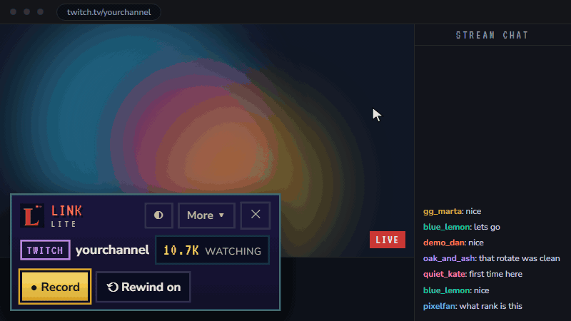
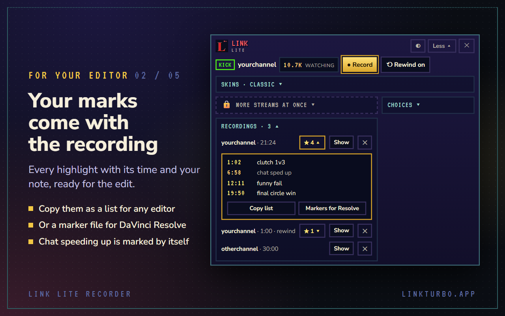
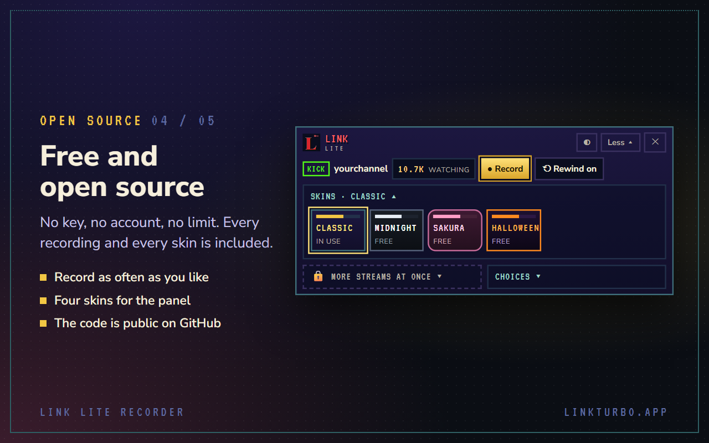

<div align="center">


# Link

**From a live stream to a clip, on your own computer.**

Free and open source. Nothing is uploaded, and there is no account.

[**Website**](https://linkturbo.app) &nbsp;·&nbsp; [**Download for Windows**](#download-link-turbo-for-windows) &nbsp;·&nbsp; [**Add to Chrome**](https://chromewebstore.google.com/detail/link-lite-recorder/jjbnifoddmcjocjdmiaondcimkjmkjaa) &nbsp;·&nbsp; [**Discord**](https://discord.gg/N3jdn6WPJd) &nbsp;·&nbsp; [**How it works**](https://linkturbo.app/how-it-works) &nbsp;·&nbsp; [**Licence: GPL-3.0**](LICENSE)

<br>



</div>

## What Link is

Link turns streams and long videos into short clips. It comes as two programs, and both are in this
repository:

| | What it is | Where |
|---|---|---|
| **Link Lite Recorder** | A browser extension for Chrome, Edge and Brave. It records the Kick or Twitch stream in your tab as one mp4, with the highlights you mark and the moments chat sped up. | [`extension/`](extension/) |
| **Link TURBO** | The full program for Windows. It records up to three streams at once (or takes a link or a file), finds the strongest moments, makes 9:16 reels with a hook and captions timed to the voice, posts them to YouTube Shorts and Instagram, and shows how they did. | [`tools/reels/`](tools/reels/) |
| **Link Night** | Part of Link TURBO: it records live streams for the hours you choose while you are away, and has the moments ranked when you are back. | [`tools/reels/night/`](tools/reels/night/) |
| **linkturbo.app** | The website's source. | [`site/`](site/), [`legal/`](legal/) |

Everything runs on your own computer. Finding the moments uses no outside
service (speech is recognised on your own PC): Link goes by loudness, movement, chat speed, the kill feed of a shooter, what is said, and
what you kept and dismissed before.

Record only streams and videos you have the right to use. The clips belong to the people who made them.

## Where things stand

- **Link Lite Recorder 0.5.0** is the version in this repository. The Chrome Web Store brings it once
  its review is through; to have it today, load it from this repository as said below.
- **Link TURBO** can be downloaded for Windows as an installer or a zip (below), and keeps itself up to
  date after that. It also runs from this repository.
- One person makes Link. Answers are not instant.

## Link Lite Recorder: quick start

1. Download this repository (Code > Download ZIP) and unpack it, or clone it.
2. Open `chrome://extensions` (or `edge://extensions`, `brave://extensions`) and switch on **Developer mode**.
3. Press **Load unpacked** and choose the folder `extension`.
4. Open a live channel on kick.com or twitch.tv, press the Link button in the toolbar, then **Record**.

The file is saved to `Downloads/Link`. Everything the extension does is described in
[extension/README.md](extension/README.md), and the guide with pictures is at
[linkturbo.app/how-it-works](https://linkturbo.app/how-it-works).

<table>
<tr>
<td></td>
<td></td>
</tr>
</table>

## Download Link TURBO for Windows

| | |
|---|---|
| [**Link-Setup.exe**](https://github.com/shushu-eco/link/releases/download/installer/Link-Setup.exe) | The installer. It puts Link in your user folder with icons on the Desktop, and fetches the speech model. No administrator rights are asked for. |
| [**Link-Windows.zip**](https://github.com/shushu-eco/link/releases/download/installer/Link-Windows.zip) | The same program without installing. Unpack it to a folder with a plain name (`C:\Link`) and double-click **Start Link**. |

Windows 10 or 11, 64-bit. Nothing else has to be installed: Python, ffmpeg and the window come with it.
The first start downloads the speech model (466 MB), which Link writes captions with.

- **Windows will warn you.** Link is not signed with a paid certificate, so Windows may say "Windows
  protected your PC". Press **More info**, then **Run anyway**. The checksums of both files are in
  [SHA256SUMS.txt](https://github.com/shushu-eco/link/releases/download/installer/SHA256SUMS.txt), and everything in them is built from this repository by
  `tools/package/build.ps1`.
- **It updates itself.** When Link starts it looks for a newer version here and takes it, but only one
  signed with Link's own key, which is not kept on GitHub. **Link
  Updater**, beside Link's own icon, shows which version you have and does the same on a press.
- **Your things stay yours.** Recordings are in your Videos folder, tapes and reels in `videos` inside
  Link's folder, settings and sign-ins in `.link` in your user folder. An update touches none of them.

## Link TURBO, the Windows program

Link TURBO is a Windows desktop program that turns a long video into short vertical reels. In its own
window and in the rest of this page it is called Link. The download above is all most people need; what
follows from "What you need" to "Install" is for running it from the code.

1. Paste a video link. The page opens inside Link, in the **Studio**.
2. Press **Record**. Link records the picture and sound itself.
   Or skip both: press **Upload video** and choose a video file you already have.
3. Link finds the strongest moments and lists them as candidates.
4. Pick the ones you like, give each a hook and captions, and render them as 9:16 reels.
5. Post them, and watch their numbers in **Analytics**.

Everything runs on your own PC. Nothing is uploaded anywhere except the reels you post yourself.

Record only videos you have the right to use. The clips belong to the people who made them.

## What you need

| | |
|---|---|
| Windows 10 or 11 | Link uses Windows-only parts |
| [Python](https://www.python.org/downloads/) 3.12 or newer | tick "Add python.exe to PATH" when installing |
| [ffmpeg](https://www.gyan.dev/ffmpeg/builds/), a recent **full** build, on the PATH | the speech recognition uses ffmpeg's `whisper` filter, which slim builds lack |
| [Node.js](https://nodejs.org/) 20 or newer | for Link's window |
| About 1.5 GB of disk space | 390 MB for the window, 470 MB for the speech model, plus your recordings |

A recording takes about 20 to 45 MB per minute.

## Install

Open PowerShell in the folder you cloned and run:

```powershell
powershell -ExecutionPolicy Bypass -File setup.ps1 -Model
```

It checks the four programs above, installs Link's parts, downloads the speech model and puts a
**Link** icon on your Desktop. Leave out `-Model` to skip the 470 MB download: Link still works,
but it cannot read what is said, so captions are not pre-filled or timed to the voice. You can run
the script again later with `-Model`.

By hand, the same steps are:

```powershell
python -m pip install -r requirements.txt
cd tools\reels\shell
npm install
```

then put [ggml-small.bin](https://huggingface.co/ggerganov/whisper.cpp/resolve/main/ggml-small.bin)
in `tools\reels\models\`, and start Link with `pythonw tools\reels\link.pyw` from the cloned folder.

## Use

Double-click **Link** on the Desktop.

- **Two ways to record from a link**, both in the sidebar: **Studio** (gold) records up to three live
  streams side by side, the minimised ones live on small monitors beside the big screen; **URL** (blue) holds one video, e.g. from YouTube, for a quick reel. A Kick
  link always goes to the Studio. A video is recorded the same way in both.
- **Video link** (strip under the top bar): paste a link, press **Open video**. In URL, and anywhere
  outside the Studio, it opens in URL; **Upload video** sits beside it there. In the Studio it is the
  **Stream link** with one button, **Run**, which puts the stream on the big screen: a Kick channel (`kick.com/channel`) opens as Kick's bare player, so only the stream is
  recorded, at full volume. While it plays, Link counts how fast its chat goes (**CHAT n/min**; no
  account needed). A recording keeps that count per second, never what was written, and the
  analysis uses chat bursts to rank the moments; the timeline shows it as a green line.
- **Studio**: make the video fill the panel with its own full-screen button (F on YouTube), then
  press **Record**. **Mark highlight** flags a moment. **Sound off** silences it for you while the
  recording keeps its sound. The Studio warns, and Record asks for a second press, when the video
  does not fill the panel or its own subtitles are on. If it warns that the video's volume is low,
  press **Set it to 100%** first. Keep the mouse off the video while recording, or its controls are
  recorded. The recording is the panel's size (shown before you start), so maximise Link for a
  sharper one.
- **Stop recording**: the recording is saved in your Videos folder and processed. It appears as a
  new tape in **Sources**.
- **Process recording** (right-click an empty part of Sources): for recordings in your Videos folder that are not tapes yet.
  With more than one, Link lists them and you tick which to process; it never takes the others.
- **Upload video** (next to the video link): choose a video file on your PC instead of recording
  one. It is processed the same way and becomes a tape with the file's name. The file is not sent
  anywhere and your original is left where it is.
- **Sources** (sidebar): the tapes on a screen of its own. It opens on the **recent tapes**: the ones
  not filed in a folder yet. A tape moved into a folder is found in that folder from then on and
  leaves the recent ones; a search or a filter looks through every tape. They are listed by day
  (TODAY, YESTERDAY, then the date), each with eight frames of the video, its length, candidates and what is left to do (green
  when every reel is rendered, amber when some are not or none are made). Click a tape to open it.
  Search, filter (All, Favourites, Has unrendered) and sort (newest, longest, most candidates) are
  above the list. The two square buttons in the corner are **Change grid** (a shelf of cards and back; Link remembers which) and, in gold, **New folder**.
- **Rename a tape**: the small pencil after its name (in Sources, and beside the title of the tape's
  own page), or **Rename** in its right-click menu. Enter keeps the name, Escape leaves it; an empty
  name takes the tape back to its date.
- **Delete a tape**: right-click it in Sources, **Delete tape** (red), and press it a second time.
  The tape's folder and Link's copy of the video go to Windows' Recycle Bin, so it can be brought
  back from there; the reels already finished from it stay in Finals. **Delete tape and its
  recording** also bins the recording in your Videos folder (otherwise Process recording would offer
  it again). Several ticked tapes are deleted together. It is refused while Link is processing or
  rendering.
- **Folders** (in Sources: **New folder**, or **+ NEW** in the row of folders): group tapes in
  folders, folders inside folders too. In the list the folders are chips: click one to see only its
  tapes; in the grid they are cards you go into, with the path on top. Drag a tape onto a folder, or
  onto **RECENT** to take it out again. Ctrl+click or Shift+click ticks several tapes to move together.
  Right-click a folder to rename it, colour it, make a folder inside it or delete it; the star (or a
  right-click) on a tape makes it a favourite. Folders only group: deleting one moves what was in it
  up a level, and the tapes themselves never move.
- **Candidates**: the moments Link found, as a list with three frames each. The chosen one sits in
  a column at the left that stays put: the player, its numbers, what is said in it and every frame.
  Step through with the arrow keys (or the ‹ › buttons), **Space** plays and pauses, **Enter** makes
  the reel, **Delete** dismisses it and moves on to the next. The recording's timeline stays on top
  with the chosen moment lit in gold. **Make a reel from any stretch** (right of the filters) opens
  the bar for a moment Link did not find itself.
- **Reels**: write the title, hook and captions, **Preview**, then **Render this reel**.
- **Suggested texts**: a reel is made with a title, a hook and a post text for YouTube Shorts and
  for TikTok already filled in, so nothing arrives empty. Link picks them from what is said in the
  reel (the sentence that reads best at a glance) and from where it came from (the Kick channel,
  or the video's own name); no outside service is asked. They are a first draft: read them over
  in **Reels** and change what you like. A reel in which nothing is said gets a plain line.
- **Finals**: the finished files, with **Post on Instagram** and copy buttons for each platform.
  Every reel is brought to the same loudness (-14 LUFS, the level the platforms play at), with
  its peaks 2 dB under full scale.

The full description of every screen is in [tools/reels/ui/README.md](tools/reels/ui/README.md).

## Instagram (optional)

The Instagram button opens your page inside the Studio. The first click asks for the page's name,
and you sign in there once.

**Analytics** shows your page's real numbers through Instagram's official API. It needs your own
access key, which only you can make:

1. In the Instagram phone app, switch the page to a professional account (Creator). A professional
   account is always public.
2. On [developers.facebook.com](https://developers.facebook.com/) create an app with the use case
   **Manage messaging & content on Instagram**.
3. In the app: **Use cases > Instagram > Permissions and features**, add `instagram_business_basic`
   and `instagram_business_manage_insights`.
4. **App roles > Roles > Add People > Instagram Tester**, add your page. Then accept the invite on
   Instagram under Settings > Apps and websites > Tester invites.
5. **API setup with Instagram login > Generate access tokens > Generate token**, and copy the key.
6. In Link: **Analytics**, paste the key, **Connect**.

The key stays on your PC and Link renews it by itself.

## YouTube Shorts (optional)

**Click a row** of either table to see that reel or Short in depth: when it was uploaded, all its
numbers, what they say (views per day, its share of your views, likes, comments and shares per 100
views), and what the API gives about that one post, read at that moment. For a Short: its views day
by day, where they came from (Shorts feed, search, ...), the top countries, watch time in total,
subscribers gained and lost, dislikes, its description and settings. For a reel: watch time in
total, plays per viewer, follows and profile visits where Instagram reports them, and the full
caption. Comment texts need an access key with the permission to manage comments.

**Analytics** has two sides, **Instagram** and **YouTube**, with the same layout. The YouTube side
shows your Shorts: subscribers, views, likes, comments, shares, how much of each Short people watch,
the subscribers each one brought, and the last 28 days. YouTube Studio itself cannot be read by a
program; these numbers come from Google's two official APIs behind it. YouTube gives no reach and no
saves for a Short. Set it up once:

1. On [console.cloud.google.com](https://console.cloud.google.com) make a project.
2. **APIs & Services > Library**: enable **YouTube Data API v3** and **YouTube Analytics API**.
3. **OAuth consent screen**: External, an app name and your e-mail. Then **Publish app**; left in
   Testing, Google ends the sign-in every 7 days. No review is needed for your own use.
4. **Credentials > Create credentials > OAuth client ID**, type **Web application**, and add
   `http://127.0.0.1:8765/youtube/callback` under **Authorised redirect URIs**, exactly.
5. In Link: **Analytics > YouTube**, paste the client's ID and secret, **Save**, then **Connect to
   YouTube** and sign in with the Google account your channel belongs to. Google says the app is not
   verified because it is your own: **Advanced**, then go on to it.

The client's secret and the sign-in stay on your PC.

## Audio and Settings

**Audio** (top bar) opens the mixer in a window of its own that stays above Link. It has one row for
each open stream, one for the URL video, one for your microphone and one for the music player:

- The **slider** sets how loud that stream is *in its recording*, in decibels (0 dB is the sound as
  it comes; up to +12 dB for a quiet stream, all the way left for no sound). It works while the
  recording runs. The meter above it shows the level going into the recording, also before you record.
- The **speaker** sets whether *you* hear it. Normally you hear only the stream on the big screen;
  press another stream's speaker to hear that one too. Recordings keep their sound either way.
- The **gear** opens the row's own settings: a limiter and mono for a stream; the device, noise
  suppression and which recordings it goes into for the microphone. Above 0 dB the limiter is on by
  itself, so a raised volume does not distort.
- The **microphone** is off until you switch it on. Your voice then goes into the recording on the
  big screen (or every recording), never into your speakers.
- What you set for a Kick channel is remembered for the next time it opens.

**Settings** (the square gear button at the end of the top bar) holds everything else in one place: General
(auto-process, the ad blocker, where recordings go), Recording (picture quality and size), Audio
(the same mixer, plus what you hear, sound quality and the remembered channels), Accounts
(Instagram, Discord, Spotify) and About (the version and Link's folders).

## Music (optional)

The mixer's **Music** row opens a small Spotify player in a window of its own: drag it anywhere, and it
stays above Link, the Studio included. It is a remote control: Spotify plays in its own app on this
PC or your phone, and the player shows the song with previous, play/pause and next. Pressing the
buttons needs Spotify Premium. Recordings never get the music, because Link records only the
Studio's own sound.

Once, to connect it:

1. On [developer.spotify.com](https://developer.spotify.com/dashboard) create an app. Tick **Web API**
   and add the redirect URI `http://127.0.0.1:8765/spotify/callback` exactly.
2. Copy the app's **Client ID** into the player and press **Save**, then **Connect to Spotify**.
3. Sign in and agree on Spotify's page in your browser, then go back to Link.

If Spotify says your account is not registered for the app, add it under **User Management** in the
app's settings. **Change ID** in the player switches to another app.

## Discord (optional)

**Discord** (top bar) opens a small widget for your own Discord bot, which runs while Link is open.
In your server it posts when a recording starts and is saved, when a tape is ready (with its best
moments), and each finished reel with a copy small enough for Discord (under 10 MB). While a Kick
stream is open in the Studio it can also relay that stream's chat into a channel of its own (e.g.
#chat), a few lines every four seconds; each kind of post has its own channel and switch in the
widget. Your crew can use three commands:

- `/record <link>`: the link waits in the widget until you press **Open in the Studio** (a Kick link) or **Open in URL** (any other). Nothing opens
  or records by itself; a red dot on the Discord button says a link came in.
- `/clip`: while you record, marks that moment as a highlight, like **Mark highlight**.
- `/status`: what Link is doing.

Only members with the role you choose (your "Apostles") and the server's owner can use them.

**Your remote.** In the widget, **Create #control** makes a channel that only you (the server's
owner) and the bot can see. There, Link is run with commands; they work for the owner only, in that
channel only, and Discord does not show them to other members.

| Command | What it does |
|---|---|
| `/list` | Every tape: id, name, length, moments, reels rendered / made, folder |
| `/tape tape:21` | One tape: its ten best moments with what is said, and its reels |
| `/open link:` | Opens a stream (Kick) or a video in Link |
| `/rec action:start` / `stop` | Records what is on screen (or the stream named in `stream`); stop ends all, or the named one |
| `/process` | Makes a tape of the newest recording that waits (`all:true` for every one) |
| `/reel tape: moment:` | Makes a reel from that moment and renders it; `title` and `hook` are optional |
| `/render tape:` | Renders the tape's reels that are not rendered yet |
| `/auto link: minutes:` | The whole way: opens the link, records that long, processes, makes reels from the best moments (`reels`, 3 unless said) and renders them |
| `/cancel` | Stops the running `/auto`; what was recorded is kept |

Each step of `/auto` is told in the channel, and the rendered videos arrive in your reels channel
as usual, each with its suggested title, hook and post text. Link has to be open on your PC. An
`/auto` records at 1280×720 whatever size Link's window is (the page is taken off the big screen
and shows as a pill); a recording you start in the Studio is as large as the Studio's panel.

**Analytics report.** Every 12 hours the bot posts how your Instagram reels and YouTube Shorts are
doing: views and reach of the last 28 days, followers and subscribers, the five most seen posts with
their links, and what changed since the last report (new views, the fastest post, new posts). It
reads the numbers fresh from the accounts connected in **Analytics**; a side that is not connected is
left out. In the widget, **Create #analytics** makes a channel for it that everyone can read and only
the bot writes in (the server's administrators can always write; Discord never locks them out). For
that the bot's role needs **Manage Channels** (Server Settings > Roles); or make a channel yourself
and choose it under **Settings > Analytics report goes to**. **Post now** sends a report at once.
Link has to be open for a report to go out: one that fell due while it was closed is posted soon
after you open Link. The numbers of the last report are kept in `%USERPROFILE%\.link\discord_summary.json`.

**Milestones.** In the same channel the bot says when a reel or a Short hits a round number, as it
happens: "Your reel ... hit 1,000 views (now 1,034)". It counts views (from 100), likes (from 10),
comments, shares and saves (from 5), and followers or subscribers (from 10), in steps of 5, 10, 25,
50, 100, 250, 500, 1,000 and so on; a jump over several steps says only the biggest. Link looks every
half hour while it is open. The first look only notes where everything stands, so nothing already
passed is announced. Its own switch, **Milestones**, is beside the others in the widget; the highest
numbers seen are kept in `%USERPROFILE%\.link\discord_milestones.json`.

Once, to set it up:

1. In the [Developer Portal](https://discord.com/developers/applications) make a **New Application**,
   open **Bot**, press **Reset Token** and copy the token.
2. In Link press **Discord**, paste the token and press **Connect**.
3. Press **Add the bot to your server**, then choose the server, the channel for posts and the role.

The bot reads no messages. It asks to see channels, send messages, embed links, attach files and
manage channels (only used to make the report's channel). Discord Nitro cannot be connected:
Discord gives apps no access to it.

## Where things are kept

| What | Where |
|---|---|
| Recordings | your `Videos` folder |
| Uploaded videos | where they were; Link works from a link to the file, or a copy in `videos\` when it is on another drive |
| Tapes, working files, finished reels | `videos\` in this folder (not part of the repository) |
| How tapes are grouped in folders | `videos\reels\folders.json` |
| Post texts | `strategy\posts\` in this folder (not part of the repository) |
| Settings, the mixer's choices (`audio.json`), Instagram key, YouTube client and sign-in (`youtube.json`), Spotify sign-in, Discord bot token, Studio sign-ins | `%USERPROFILE%\.link` |

## If something does not work

- **Link does not open, or says its server could not start**: read `%USERPROFILE%\.link\link.log`.
- **Processing, a render or a preview went wrong**: the same `link.log` has the full output of every
  job, with the time.
- **"Link's window program is not installed"**: run `npm install` in `tools\reels\shell`.
- **No transcript and empty captions**: the speech model is missing, or ffmpeg has no `whisper`
  filter (`ffmpeg -filters` must list it). Link listens for English; game noise and music give no
  captions rather than invented ones.
- **Ads in the Studio, or a video that will not play**: untick **Block ads** for that video.

## Working on it with Claude Code

The folder has a runbook for Claude Code in `.claude/skills/stream-reels/`. Say "run Link" and it
picks the moments and writes the hooks and captions for you to adjust in the Reels tab.

## Working on Link

- The extension has no build step: change a file in `extension/` and reload it at `chrome://extensions`.
  `node store/freetest.js` tries it in a browser nobody sees.
- Link's window is tried with the two scripts in `tools/reels/test/` (a copy of the library, then the
  window driven through it).
- The website is built with `node site/build.js` into `site/out`.
- Problems and ideas: open an issue here, or say it in [Discord](https://discord.gg/N3jdn6WPJd). Changes
  are welcome as pull requests. The code is developed in a private copy and published here from it
  (`tools/package/publish.ps1`), so a pull request is taken over by hand and may land as part of a
  larger commit.

## Licence

Link is free software under the [GNU General Public License, version 3](LICENSE): you may use it, study
it, change it and pass it on, and a changed version that is passed on must be open under the same
licence. It comes without warranty.

The programs and files made by others that Link uses stay under their own licences; they are listed
in [tools/package/licenses/NOTICES.txt](tools/package/licenses/NOTICES.txt). The name "Link" and its
logo, as used for this software, are not part of the licence.

Not affiliated with Kick, Twitch, YouTube, Instagram, Discord or Spotify.
